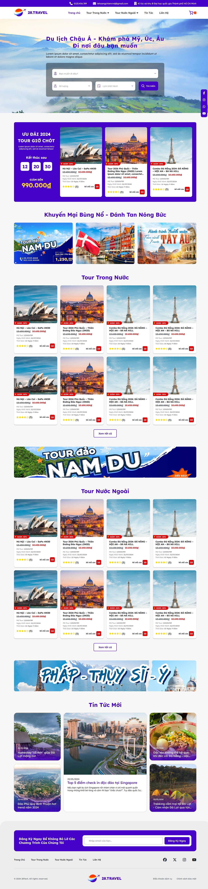
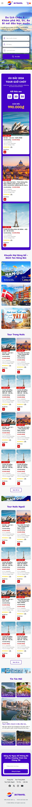
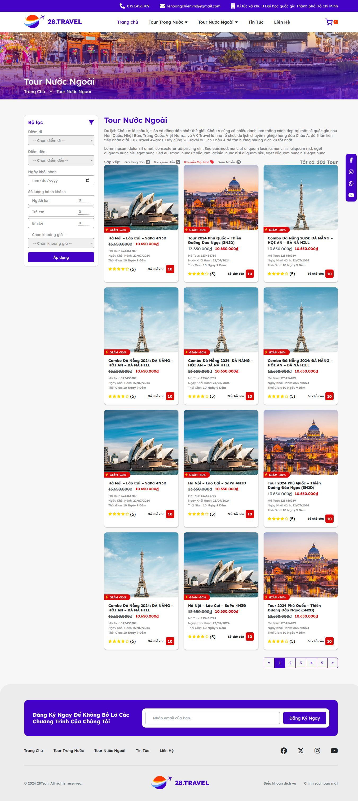
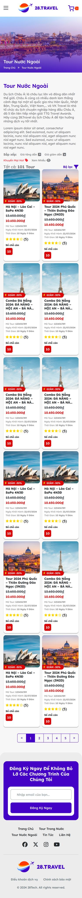
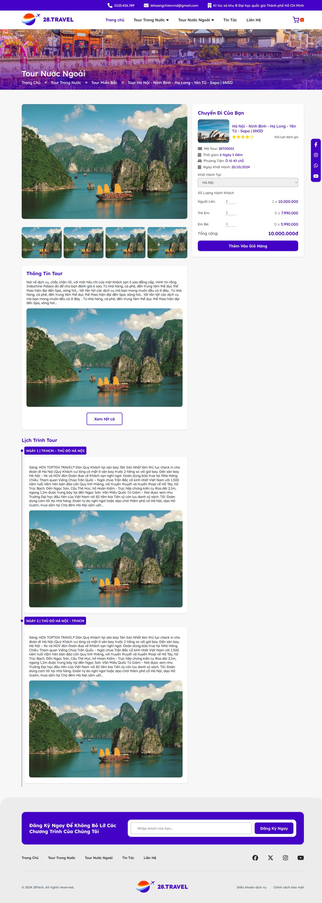
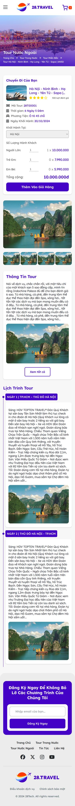
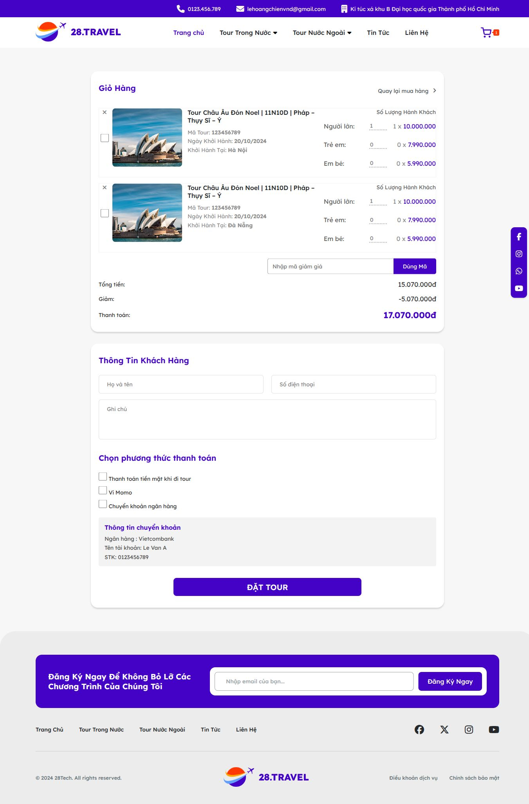
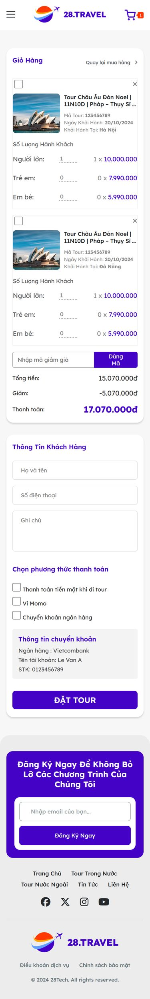

# 28.TRAVEL – Website Đặt Tour Du Lịch

Giao diện website đặt tour du lịch trong nước và quốc tế, được cắt (slice) từ thiết kế Figma sang **HTML/CSS thuần**, responsive trên desktop, tablet và mobile.

🔗 **Demo:** https://project-1-bljb.onrender.com/ *(host miễn phí trên Render, lần đầu truy cập có thể mất vài giây để khởi động)*
📁 **Source code:** https://github.com/LEHOANGCHIEN/travel-tour-website

---

## Mục lục

- [Tổng quan](#tổng-quan)
- [Ảnh chụp giao diện](#ảnh-chụp-giao-diện)
- [Công nghệ sử dụng](#công-nghệ-sử-dụng)
- [Các trang đã thực hiện](#các-trang-đã-thực-hiện)
- [Điểm nổi bật](#điểm-nổi-bật)
- [Cấu trúc thư mục](#cấu-trúc-thư-mục)
- [Chạy dự án](#chạy-dự-án)
- [Hướng phát triển](#hướng-phát-triển)
- [Tác giả](#tác-giả)

## Tổng quan

28.TRAVEL là website giới thiệu và đặt tour du lịch. Người dùng có thể tìm tour, xem danh sách tour theo danh mục, xem chi tiết lịch trình, thêm tour vào giỏ hàng và điền thông tin để đặt tour.

Mục tiêu của dự án là chuyển thiết kế Figma thành giao diện web sát với bản thiết kế (pixel-perfect) và hiển thị tốt trên mọi kích thước màn hình.

## Ảnh chụp giao diện

> Bấm vào từng mục để xem ảnh chụp toàn trang.

<details open>
<summary><b>Trang chủ</b></summary>
<br>
<table>
  <tr>
    <th>Desktop</th>
    <th>Mobile</th>
  </tr>
  <tr>
    <td valign="top"></td>
    <td valign="top"></td>
  </tr>
</table>
</details>

<details>
<summary><b>Danh sách tour</b></summary>
<br>
<table>
  <tr>
    <th>Desktop</th>
    <th>Mobile</th>
  </tr>
  <tr>
    <td valign="top"></td>
    <td valign="top"></td>
  </tr>
</table>
</details>

<details>
<summary><b>Chi tiết tour</b></summary>
<br>
<table>
  <tr>
    <th>Desktop</th>
    <th>Mobile</th>
  </tr>
  <tr>
    <td valign="top"></td>
    <td valign="top"></td>
  </tr>
</table>
</details>

<details>
<summary><b>Giỏ hàng</b></summary>
<br>
<table>
  <tr>
    <th>Desktop</th>
    <th>Mobile</th>
  </tr>
  <tr>
    <td valign="top"></td>
    <td valign="top"></td>
  </tr>
</table>
</details>

## Công nghệ sử dụng

| Công nghệ | Mục đích |
|---|---|
| **HTML5** | Cấu trúc trang, thẻ ngữ nghĩa (`nav`, `footer`, `form`, …) |
| **CSS3** | Flexbox, CSS Grid, CSS Variables, Media Queries |
| **Google Fonts** | Font *Lexend Deca* |
| **Font Awesome 6** | Bộ icon |
| **Figma** | Đọc thiết kế, lấy kích thước, màu sắc và asset |

## Các trang đã thực hiện

| Trang | File | Nội dung chính |
|---|---|---|
| Trang chủ | `index.html` | Banner và form tìm tour, khối ưu đãi giờ chót có đồng hồ đếm ngược, banner khuyến mại, danh sách tour trong nước và nước ngoài, tin tức mới, footer đăng ký nhận tin |
| Danh sách tour | `tour-list.html` | Breadcrumb, bộ lọc (điểm đi, điểm đến, ngày khởi hành, số khách, mức giá), sắp xếp, lưới tour, phân trang |
| Chi tiết tour | `tour-detail.html` | Thư viện ảnh, thông tin tour, lịch trình theo ngày dạng timeline, box đặt chỗ chọn số lượng hành khách |
| Giỏ hàng | `cart.html` | Danh sách tour đã chọn, mã giảm giá, tổng tiền, form thông tin khách hàng, chọn phương thức thanh toán |

Các phần dùng chung trên mọi trang: top header, header có menu đa cấp (dropdown), footer và thanh liên hệ mạng xã hội cố định bên phải màn hình.

## Điểm nổi bật

- **Responsive theo 5 mức màn hình**, container co giãn theo từng breakpoint:

  | Màn hình | Breakpoint | Độ rộng container |
  |---|---|---|
  | Desktop | > 1200px | 1184px |
  | Laptop nhỏ | ≤ 1200px | 960px |
  | Tablet ngang | ≤ 992px | 720px |
  | Tablet dọc / Mobile ngang | ≤ 768px | 540px |
  | Mobile | ≤ 576px | 100% (padding 16px) |

- **Component tái sử dụng**: thẻ tour (`.product-item`), tiêu đề khối (`.box-title`), nút viền (`.button-outline`), breadcrumb (`.box-breadcrumb`), phân trang (`.box-pagination`) được viết một lần và dùng lại ở nhiều trang.
- **Quy ước đặt tên class nhất quán**: khối chính (`section-*`, `box-*`) kết hợp với phần tử con có tiền tố `inner-*`, giúp CSS dễ đọc và tránh xung đột.
- **CSS Variables** cho màu chủ đạo (`--color-main: #4502C7`), đổi theme chỉ cần sửa một chỗ.
- **Menu dropdown đa cấp** viết bằng CSS thuần (`:hover`), không cần JavaScript.
- Bố cục phức tạp như khối tin tức dạng lưới không đều, timeline lịch trình tour, layout hai cột sidebar + nội dung đều dùng Flexbox và Grid.

## Cấu trúc thư mục

```
travel-tour-website/
├── index.html            # Trang chủ
├── tour-list.html        # Danh sách tour
├── tour-detail.html      # Chi tiết tour
├── cart.html             # Giỏ hàng & đặt tour
├── docs/
│   └── screenshots/      # Ảnh chụp giao diện dùng trong README
└── assets/
    ├── css/
    │   └── style.css     # Toàn bộ style, chia theo từng section/component
    └── images/
        ├── Logo.svg
        ├── icon-*.svg    # Icon giao diện
        └── demo/         # Ảnh minh hoạ (banner, tour, blog)
```

## Chạy dự án

Dự án không cần cài đặt hay build.

```bash
git clone https://github.com/LEHOANGCHIEN/travel-tour-website.git
cd travel-tour-website
```

Sau đó mở file `index.html` bằng trình duyệt, hoặc dùng extension **Live Server** của VS Code để tự tải lại trang khi sửa code.

## Hướng phát triển

- [ ] Thêm JavaScript: menu mobile, slider cho khối ưu đãi và banner, dropdown chọn điểm đến / số lượng khách, đồng hồ đếm ngược chạy thật
- [ ] Tính tổng tiền giỏ hàng tự động theo số lượng hành khách
- [ ] Validate form đặt tour
- [ ] Kết nối backend (Node.js / Express + cơ sở dữ liệu) để quản lý tour, giỏ hàng và đơn đặt tour; trang quản trị nằm ở repo [travel-tour-admin](https://github.com/LEHOANGCHIEN/travel-tour-admin)

## Tác giả

**Lê Hoàng Chiến**

- GitHub: [@LEHOANGCHIEN](https://github.com/LEHOANGCHIEN)

---

> Thiết kế giao diện được tham khảo từ bản Figma của khoá học lập trình web tại 28Tech. Hình ảnh trong dự án chỉ dùng cho mục đích học tập.
